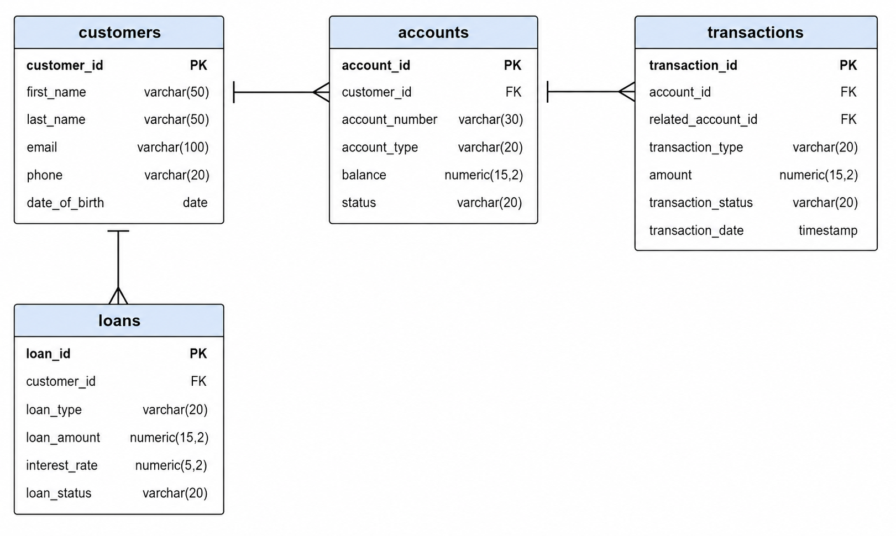
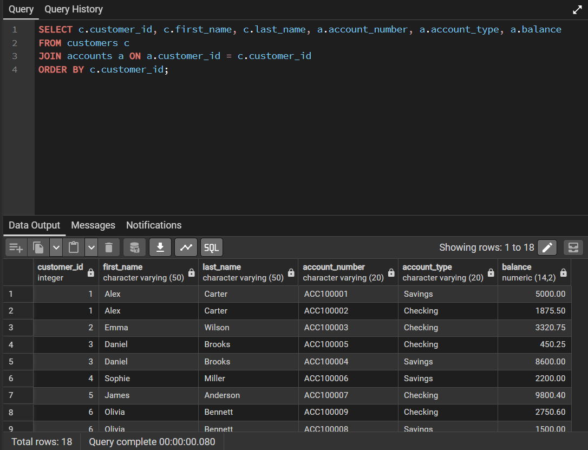
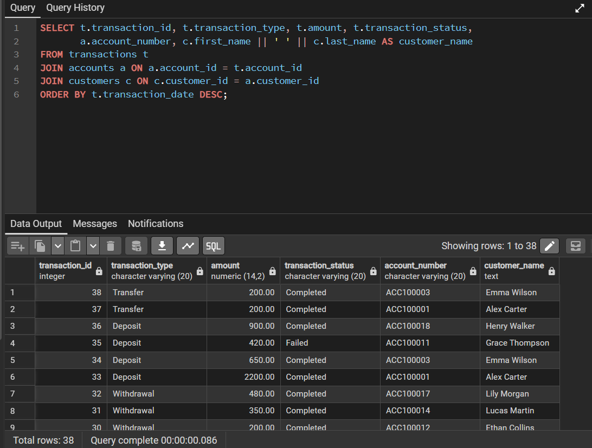
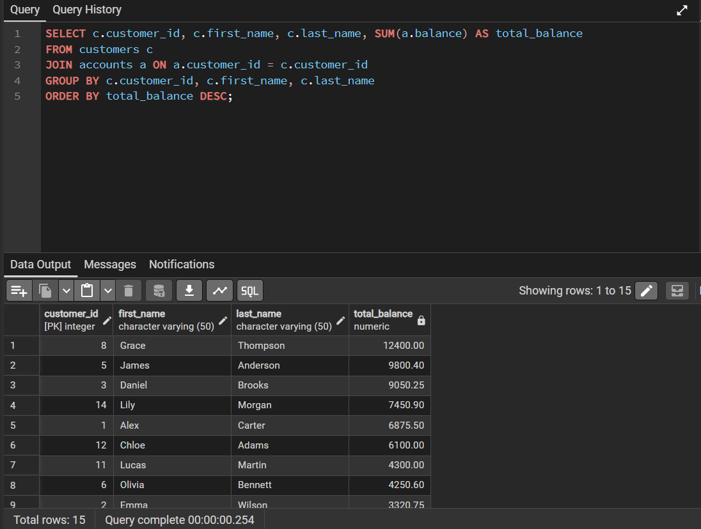
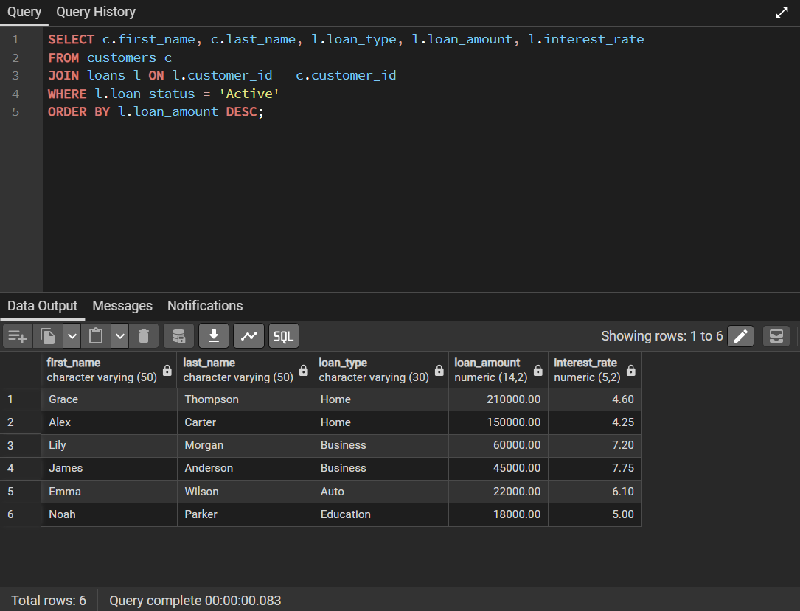
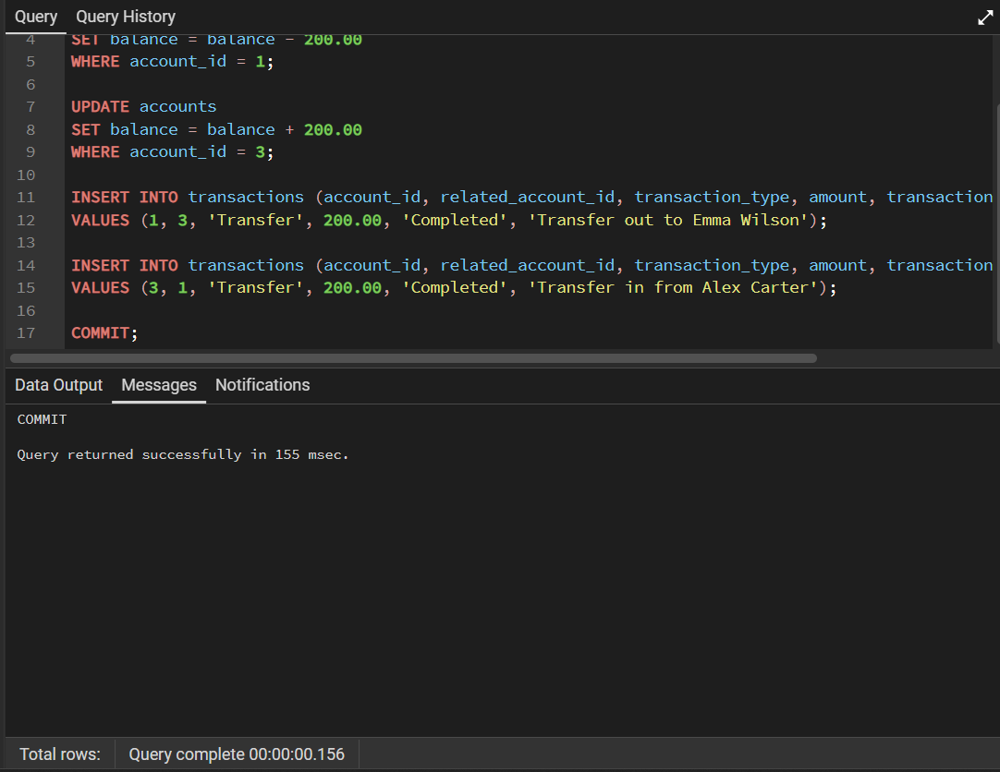

# Bank Management System

## Overview

The Bank Management System is a relational database built in PostgreSQL that models the core operations of a retail bank: customers, their accounts, the transactions that move money through those accounts, and the loans a bank issues. It uses fictional, sample banking data throughout and is designed to demonstrate solid relational database design, safe SQL query writing, and correct use of PostgreSQL database transactions.

## Features

- Normalized schema for customers, accounts, transactions, and loans
- Primary key / foreign key relationships enforcing referential integrity
- Data validation through `CHECK`, `NOT NULL`, `UNIQUE`, and `DEFAULT` constraints
- 30+ ready-to-run SQL queries covering filtering, joins, aggregation, and subqueries
- Worked examples of PostgreSQL transactions, `COMMIT`, and `ROLLBACK`
- A discussion of how the schema and transaction examples relate to ACID properties
- An optional view for quick account lookups

## Technologies Used

- PostgreSQL
- pgAdmin (Query Tool)
- SQL (DDL, DML, DQL, transaction control)
- Git & GitHub for version control

## Database Design

The database is named **`bank_management_system`** and consists of four core tables: `customers`, `accounts`, `transactions`, and `loans`. Monetary values use the `NUMERIC` type rather than floating-point types to avoid rounding errors, and transaction amounts are constrained to positive values.

## Database Tables

| Table | Purpose |
|---|---|
| `customers` | Stores the people who hold accounts and/or loans at the bank |
| `accounts` | Stores each bank account, including its type, status, and current balance |
| `transactions` | Records every deposit, withdrawal, and transfer made on an account |
| `loans` | Records loans issued to customers, including amount, rate, and status |

## Relationships

- **One customer → many accounts**: a customer can open multiple `Savings` or `Checking` accounts (`accounts.customer_id` references `customers.customer_id`).
- **One account → many transactions**: every deposit, withdrawal, or transfer is logged against the account it was performed on (`transactions.account_id` references `accounts.account_id`). Transfers also store the paired `related_account_id` so a transfer's counterpart account can be traced without a separate transfer table.
- **One customer → many loans**: a customer can hold multiple loans of different types (`loans.customer_id` references `customers.customer_id`).

## ER Diagram



## SQL Concepts Demonstrated

- Table design with `PRIMARY KEY`, `FOREIGN KEY`, `UNIQUE`, `NOT NULL`, `CHECK`, and `DEFAULT`
- `INNER JOIN`, `LEFT JOIN`, and multi-table joins
- Aggregate functions: `COUNT`, `SUM`, `AVG`, `MIN`, `MAX`
- `GROUP BY` and `HAVING`
- `CASE` expressions
- Subqueries
- Date/time functions (`EXTRACT`, `TO_CHAR`, `AGE`, `CURRENT_DATE`)
- Database transactions and ACID properties

## Database Transactions

`sql/04_transactions.sql` walks through four scenarios using PostgreSQL's transaction control statements (`BEGIN`, `COMMIT`, `ROLLBACK`):

1. A successful fund transfer between two accounts, committed as a single unit.
2. A `ROLLBACK` example showing an in-progress change being fully undone.
3. A transaction that fails because it violates a `CHECK` constraint, showing that PostgreSQL prevents the database from reaching an invalid state.
4. An atomic transfer that debits one account, credits another, and logs both transaction records — succeeding or failing together.

## ACID Properties

- **Atomicity** — A transaction's statements are treated as a single unit: they either all succeed and are committed, or all fail and are rolled back. Demonstrated by the multi-statement transfer transactions.
- **Consistency** — Constraints such as `CHECK (balance >= 0)` ensure the database can never be left in an invalid state, even if a transaction is interrupted partway through.
- **Isolation** — While a transaction is open, its uncommitted changes are not visible to other sessions; PostgreSQL enforces this through its default Read Committed isolation level.
- **Durability** — Once a transaction is committed, the change is written to disk and survives a subsequent server restart.

**Example:** transferring $200 from Account A to Account B requires two updates (debit A, credit B). Atomicity ensures both updates happen together — if the credit to B failed after A was already debited, the money would simply vanish. Wrapping both statements in a single transaction prevents that.

## Example Queries

A few samples from `sql/03_queries.sql` (38 total):

```sql
-- Customers with more than one account
SELECT c.customer_id, c.first_name, c.last_name, COUNT(a.account_id) AS account_count
FROM customers c
JOIN accounts a ON a.customer_id = c.customer_id
GROUP BY c.customer_id, c.first_name, c.last_name
HAVING COUNT(a.account_id) > 1
ORDER BY account_count DESC;
```

```sql
-- Total balance held by each customer
SELECT c.customer_id, c.first_name, c.last_name, SUM(a.balance) AS total_balance
FROM customers c
JOIN accounts a ON a.customer_id = c.customer_id
GROUP BY c.customer_id, c.first_name, c.last_name
ORDER BY total_balance DESC;
```

See `sql/03_queries.sql` for the complete, numbered set of queries.

## Screenshots

| Screenshot | Description |
|---|---|
|  | Customers joined with their accounts |
|  | Transaction history with account and customer details |
|  | Total balance held by each customer |
|  | Active loans grouped and summarized |
|  | A committed transfer transaction in action |

## Project Structure

```
bank-management-system/
│
├── README.md
│
├── sql/
│   ├── 01_create_tables.sql
│   ├── 02_insert_data.sql
│   ├── 03_queries.sql
│   ├── 04_transactions.sql
│   └── 05_create_views.sql
│
├── diagrams/
│   └── ER_diagram.png
│
└── screenshots/
    ├── customers_accounts.png
    ├── transaction_history.png
    ├── account_balances.png
    ├── loan_analysis.png
    └── transaction_demo.png
```

## How to Run

1. Open **pgAdmin** and create a new database named `bank_management_system`.
2. Open the **Query Tool** on that database.
3. Run `sql/01_create_tables.sql` to create the schema.
4. Run `sql/02_insert_data.sql` to load the sample data.
5. Run `sql/03_queries.sql` to explore the data.
6. Run `sql/04_transactions.sql` to see the transaction and ACID examples (read the in-file comments first — some examples modify balances).
7. Run `sql/05_create_views.sql` to create the optional summary view.

## Important Notes

- All customer names, emails, phone numbers, account numbers, and financial figures in this database are **fictional** and created solely for demonstration purposes. No real banking or personal data is used.
- Running `sql/04_transactions.sql` in full is safe: it includes a deliberate constraint-violation example that is expected to raise an error before rolling itself back, and the balance changes it makes are small and self-contained.

## Future Improvements

- Add stored procedures/functions to encapsulate transfer logic
- Add role-based access control for different bank staff roles
- Add interest accrual and loan repayment scheduling
- Add automated tests for constraint behavior
